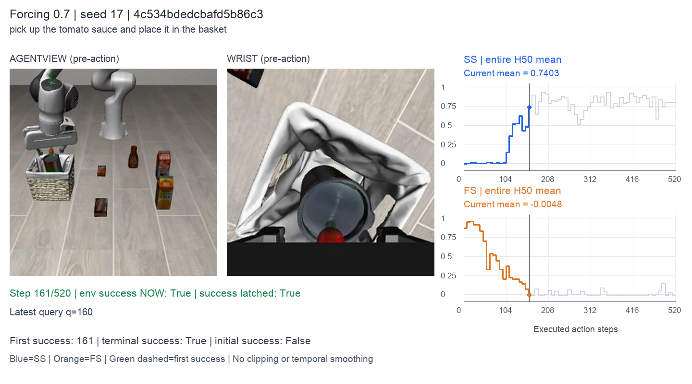
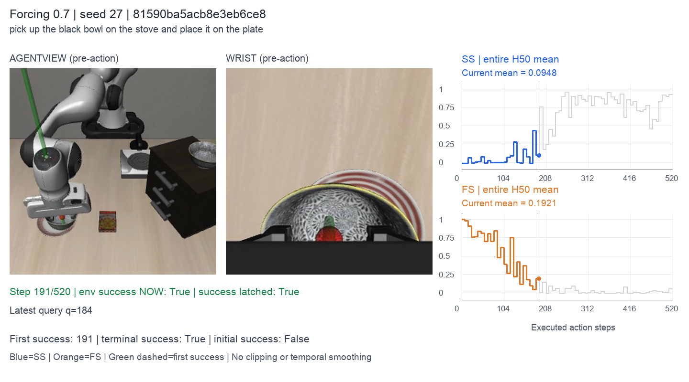
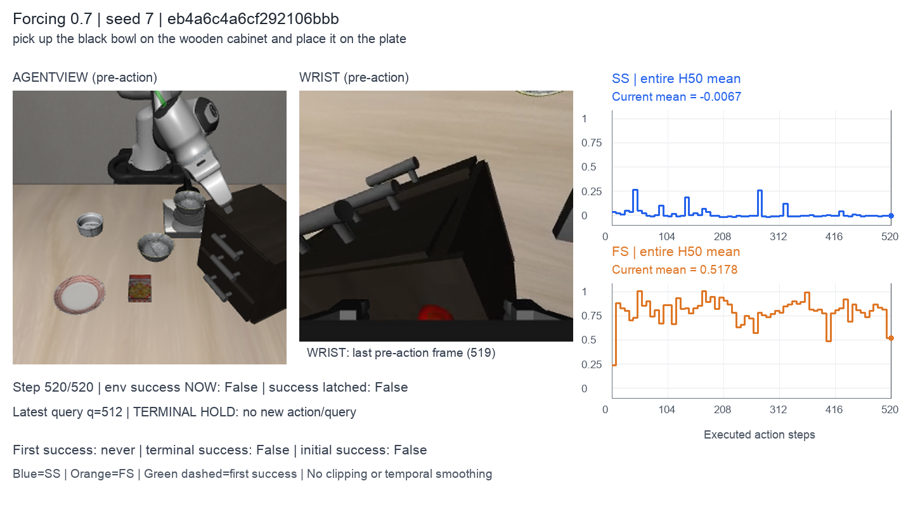

# Echo: Coupled Action and Task Status Signal Denoising for Vision Language Action Models

Official simulation code for **Echo: Coupled Action and Task Status Signal Denoising for Vision Language Action Models**, built on π0.5 and LIBERO-Recovery.

[Project page](https://lyfeng001.github.io/Echo/) ·
[Paper](https://lyfeng001.github.io/Echo/assets/paper/Echo.pdf) ·
[Failure dataset](https://huggingface.co/datasets/echo-iclr/echo-failure-libero)

Echo jointly denoises robot actions, a Stop Signal (SS), and a Failure Signal
(FS). The signals describe task progress while sharing the action model's
representations. This repository provides three-type training with success,
recovery and terminal-failure trajectories, a π0.5 action-only baseline, and
simulation evaluation with synchronized video and signal visualization.

## Results

Success rates on 150 LIBERO-Recovery scenes, with 1,500 trials per evaluation
seed. All checkpoints below were fine-tuned for 2,500 updates. The baseline and
Echo use the same scenes, perturbations and canonical task instructions.

| Model | Training data | Seed 7 | Seed 17 | Seed 27 | Mean |
| --- | --- | ---: | ---: | ---: | ---: |
| π0.5, joint training | Success + recovery | 32.87% | 31.07% | 34.07% | 32.67% |
| **Echo, τ<sub>clean</sub> = 0.7** | Success + recovery + failure | **34.47%** | **34.67%** | **35.13%** | **34.76%** |

Echo results use complete 520-action rollouts, including after success. Task
success is counted at its first occurrence within the 520-action horizon.
See [results and protocol](docs/experiments.md) for counts and checkpoint identities.

### Signal accuracy

Echo (τ<sub>clean</sub> = 0.7) on all 4,500 full-horizon trials. SS and FS are
averaged over the entire H50 chunk, with thresholds of 0.5 and a 3-second
post-success window.

| Metric | Seed 7 | Seed 17 | Seed 27 | Overall |
| --- | ---: | ---: | ---: | ---: |
| Frame accuracy | 89.76% | 90.55% | 89.58% | **89.97%** |

Frame accuracy scores Ongoing (SS < 0.5) before success and throughout timeouts,
and Success (SS > 0.5 and FS < 0.5) during the post-success window. Later frames
are excluded, and predictions are held between queries. Overall accuracy pools
correct and total frame counts across seeds. See the
[metric definition](docs/evaluation.md#signal-accuracy) and
[exact counts](docs/experiments.md#signal-accuracy-results).

## Videos and task status signals

The examples below come from one τ<sub>clean</sub> = 0.7 checkpoint. Curves show
SS and FS averaged over the **entire 50-step predicted chunk**. The green line
marks the first environment success; the policy continues to the time limit.
Click a preview to open its synchronized video.

| Success: tomato sauce → basket | Success: object placement | Timeout example |
| --- | --- | --- |
| [](assets/demos/success_1.mp4) | [](assets/demos/success_2.mp4) | [](assets/demos/timeout.mp4) |

[All six randomly sampled examples](docs/demos.md) ·
[Visualization and sampling](docs/evaluation.md#visualization) ·
[Signal accuracy definitions](docs/evaluation.md#signal-accuracy)

## Environment setup

Linux, Python 3.10 and an NVIDIA GPU. The reference training setup uses
4 × A100 80 GB, global batch 128, PyTorch 2.6.0 and CUDA 12.4.
Run the following commands from the repository root:

```bash
sudo apt-get install -y ffmpeg git-lfs libegl1 libgl1 libosmesa6
git lfs install
python3.10 -m venv .venv
source .venv/bin/activate
python -m pip install --upgrade pip
python -m pip install torch==2.6.0 torchvision==0.21.0 --index-url https://download.pytorch.org/whl/cu124
python -m pip install -r requirements-echo.txt
python -m pip install --no-deps -e LIBERO
export PYTHONPATH="$PWD:$PWD/LIBERO${PYTHONPATH:+:$PYTHONPATH}"
export MUJOCO_GL=egl
export WANDB_MODE=disabled
```

## Training data

| Type | Source | Trajectories |
| --- | --- | ---: |
| Success | [physical-intelligence/libero](https://huggingface.co/datasets/physical-intelligence/libero) + [yzembodied/libero_90_image](https://huggingface.co/datasets/yzembodied/libero_90_image) | 6,193 |
| Recovery | [LIBERO_Recovery_Expert](https://www.modelscope.cn/datasets/ataier/LIBERO_Recovery_Expert) | 3,184 |
| Terminal failure | [echo-iclr/echo-failure-libero](https://huggingface.co/datasets/echo-iclr/echo-failure-libero) | 9,521 |

Recovery demonstrations come from LIBERO-Recovery; success demonstrations come
from the two public LIBERO datasets linked above. Input revisions, local paths,
[initial π0.5 weights](https://huggingface.co/tenstep/pi_model_starvla) and
[evaluation scenes](https://www.modelscope.cn/datasets/ataier/LIBERO_Recovery_Assets)
are specified in [configs/data.json](configs/data.json).

```bash
python -m echo.data.fetch --source all
python -m echo.data.validation
```

Downloads go to `data/`. Use `--source success`, `success90`, `recovery`,
`failure`, `weights` or `assets` to fetch individual inputs.
See [data preparation](docs/data.md) for formats and validation.

## Training

| Config | Model | τ<sub>clean</sub> |
| --- | --- | ---: |
| [echo_tau07.json](configs/echo_tau07.json) | Echo, asynchronous denoising | 0.7 |
| [echo_tau0.json](configs/echo_tau0.json) | Echo, synchronous denoising | 0 |
| [baseline.json](configs/baseline.json) | π0.5, success + recovery | — |

```bash
python -m echo.training.train --config configs/echo_tau07.json --preflight
CUDA_VISIBLE_DEVICES=0,1,2,3 torchrun --standalone --nproc_per_node=4 \
  -m echo.training.train --config configs/echo_tau07.json
```

Choose another config to train the corresponding model. Copy a config to
change `tau_clean`, learning rate, batch size or training length, and use a new
`run_dir`. Defaults: 2,500 updates, 125-step warmup, cosine LR from 1e-5 to 1e-6.
[Training guide](docs/training.md) covers configuration, losses and exact resume.

## Evaluation and analysis

Edit [configs/evaluation.json](configs/evaluation.json) to select the checkpoint,
evaluation manifest and output directory. Seeds 7, 17 and 27 are provided in
`manifests/`. Evaluation always executes 520 actions and counts a trial as
successful when the environment first reports success.

**Simulator rendering:** the default MuJoCo/EGL renderer does not guarantee
pixel-identical images, even with fixed seeds. This is a simulator rendering
issue; small pixel differences can affect subsequent actions and outcomes.
See [rendering reproducibility](docs/evaluation.md#rendering-reproducibility).

```bash
# Evaluate; rerun the same command to continue an interrupted evaluation.
CUDA_VISIBLE_DEVICES=0 python -m echo.evaluation.evaluate --config configs/evaluation.json

# Summarize success rates and monitor the baseline on the same completed trials.
python -m echo.evaluation.results summary --run runs/eval_tau07_seed7 --manifest manifests/evaluation_seed7.json
python -m echo.evaluation.results monitor --run runs/eval_tau07_seed7 \
  --baseline runs/eval_baseline_seed7 --manifest manifests/evaluation_seed7.json --watch 60

# Random video gallery, signal curves and signal accuracy.
python -m echo.evaluation.visualize --run runs/eval_tau07_seed7 \
  --manifest manifests/evaluation_seed7.json --config configs/signals.json
python -m echo.evaluation.signals --run runs/eval_tau07_seed7 \
  --manifest manifests/evaluation_seed7.json --config configs/signals.json
```

[Evaluation guide](docs/evaluation.md) explains new random seeds, GPU sharding,
visualization and frame-level signal accuracy. Thresholds and the
post-success window (default: 3 seconds) are editable in `configs/signals.json`.

## Code organization

```text
.
├── echo/
│   ├── models/       π0.5, Echo signal tokens, initialization and inference
│   ├── data/         source readers, sampling, downloads and validation
│   ├── training/     training loop, distributed execution and checkpoints
│   └── evaluation/   scene selection, rollouts, summaries, signals and plots
├── configs/          editable experiment settings
├── manifests/        fixed training segments, scenes and task instructions
├── tests/
│   └── echo/         numerical, data, checkpoint and rollout regression tests
├── LIBERO/           simulation environment and required scene assets
└── starVLA/          π0.5 backbone and its shared dependencies
```

Run the core tests with `python -m unittest discover -s tests/echo -v`.
See [development checks](docs/development.md) for coverage.

## Acknowledgements

This code builds on [LIBERO-Recovery](https://github.com/liulin815/LIBERO-Recovery)
for recovery data and scene restoration,
[LIBERO](https://github.com/Lifelong-Robot-Learning/LIBERO) for simulation,
[StarVLA](https://github.com/starVLA/starVLA) for the PyTorch π0.5 implementation,
and [OpenPI](https://github.com/Physical-Intelligence/openpi) for π0.5.
We thank these projects and the providers of the public datasets and weights.
[Third-party provenance](THIRD_PARTY.md) identifies the retained components.
