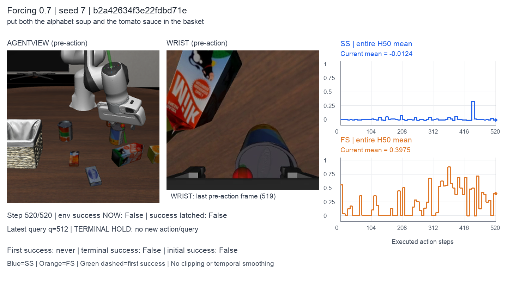
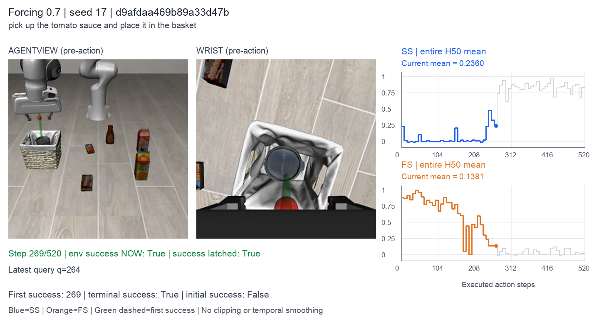
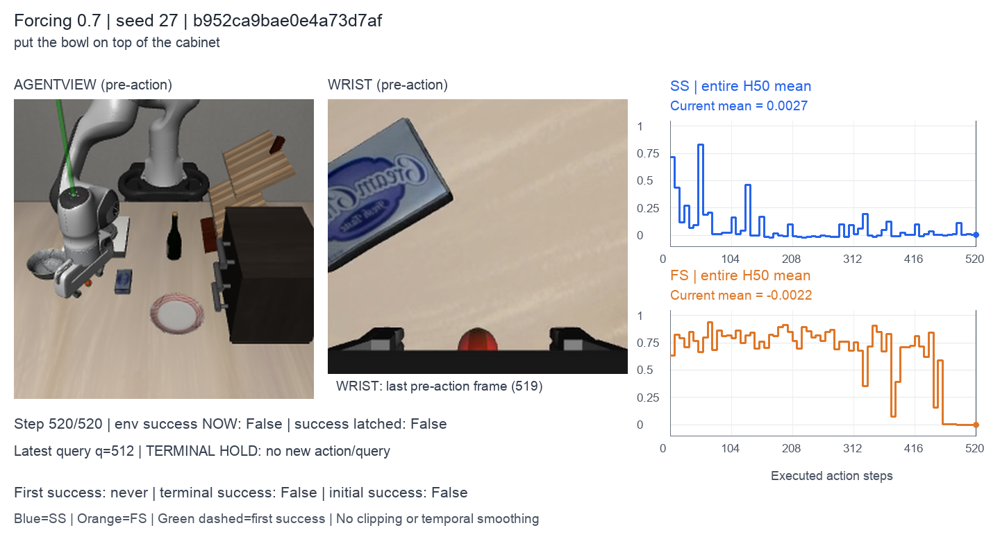

# Videos and task status signals

Six randomly sampled trials from the same Echo checkpoint (τclean = 0.7).
Click a preview to play the video. Blue: SS; orange: FS; green: first environment
success. Each curve uses the whole H50 mean.

### Seed 7 — Timeout

[](../assets/demos/timeout.mp4)

### Seed 7 — Timeout

[](../assets/demos/example_2.mp4)

### Seed 17 — Success at action 161

[](../assets/demos/success_1.mp4)

### Seed 17 — Success at action 269

[](../assets/demos/example_4.mp4)

### Seed 27 — Success at action 191

[](../assets/demos/success_2.mp4)

### Seed 27 — Timeout

[](../assets/demos/example_6.mp4)

To open the local video gallery:

```bash
python -m http.server 8000 --bind 127.0.0.1 --directory assets/demos
```

Open `http://127.0.0.1:8000/`. Sampling metadata and checksums are in
[examples.json](../assets/demos/examples.json). See
[evaluation.md](evaluation.md#visualization) to visualize new evaluations.
